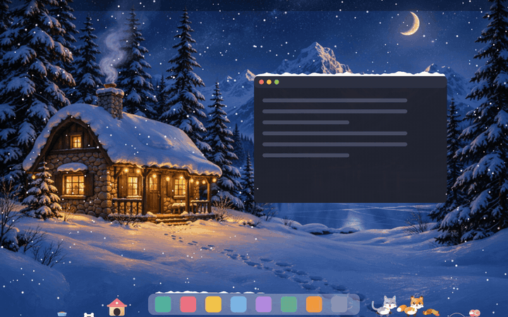
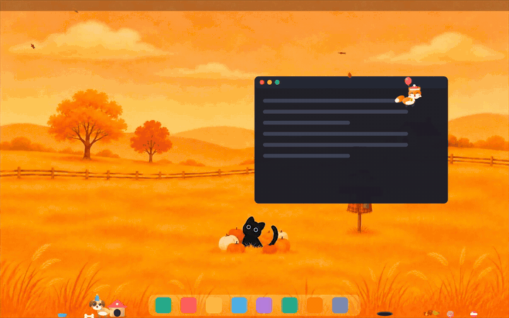
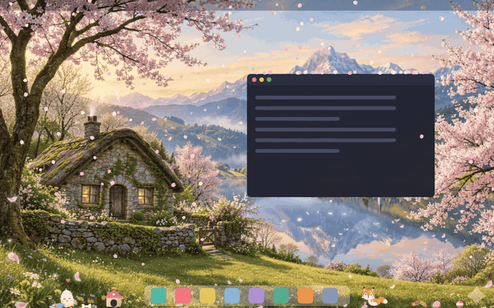

# Tuft

A small menu bar app for macOS that puts weather, painted wallpapers and a pet on your desktop.

Snow piles up on your windows and slides off when you drag them. A fox, cat, bunny, panda or one of four other pets lives beside the Dock, reacts to what you do, and stays out of the way while you work.



*Recorded from the app. The window and Dock here are a mock desktop; on your Mac it is your real windows and Dock.*

## See it

| Autumn leaves, golden hour | Spring petals, morning |
|---|---|
|  |  |

**The eight pets**, each shown normal, happy (with a hat), surprised, sad and asleep, plus the decorations:


**The built-in wallpapers**, a day and a night painting for each season:


## Install

Tuft is not signed with an Apple developer certificate, so macOS blocks it the first time. This is expected.

1. Download `Tuft.zip` from the [latest release](../../releases/latest) and unzip it.
2. Drag `Tuft.app` into your **Applications** folder.
3. Double-click it. macOS says it cannot be opened. Click **Done**.
4. Open **System Settings ▸ Privacy & Security**, scroll down to the message about Tuft, and click **Open Anyway**. Confirm with your password or Touch ID.
5. Tuft starts. Look for the weather icon in the menu bar; there is no Dock icon and no window.

If step 4 shows nothing, run this in Terminal and open the app again:

```bash
xattr -dr com.apple.quarantine /Applications/Tuft.app
```

**Requirements:** macOS 14 or later, Apple silicon (M1 or newer).

Tuft needs no permissions. It never records your screen and never reads what you type.

## What it does

Everything is in the menu bar icon.

### Weather
- **Six kinds:** snow, leaves, starfall, rain, sakura, fireflies.
- **Snow piles** on window tops and the Dock, in uneven drifts, and falls off when a window moves. Set how deep under **Snow depth**.
- **The pointer pushes things around:** it parts falling snow, scatters resting leaves, and fireflies gather when it rests.
- **Match real weather:** type your city once and Tuft follows the actual conditions.

### Wallpapers
- Eight painted scenes: a day and a night painting for each season, tinted for dawn, sunrise, morning, midday, golden hour, sunset, dusk and night.
- The season follows the weather you pick. **Follow time of day** changes the tint as the day goes on.
- **Restore my wallpaper** puts your own picture back.
- **Use my own pictures:** opens a folder for your own images. Name them by season (`winter-night.jpg`) or as a full scene with one picture per time of day (`snow-dawn.jpg` … `snow-night.jpg`); full scenes show up under **Wallpaper ▸ Scene**.

### Pets
- **Fox, cat, dog, bunny, panda, hamster, penguin or egg**, plus an optional second pet. Each can have a hat, a scarf or collar colour, and a name.
- **Where they live:** both sides of the Dock, a bottom corner, on the Dock, or on the menu bar. With two pets, they spend about half the time together and half on opposite sides.
- **Menu bar trips:** now and then a pet pops up to the menu bar by magic or balloon, strolls along it, and comes back down.
- **They react to you:** they sit and sway beside you while you type, check in with a little speech bubble when you have worked a long stretch, startle at nearby clicks, watch the pointer, nap when you're away and greet you when you come back. Rest the pointer on one to pet it.
- **Toys:** a ball, yarn, a leaf pile and a burrow on one side of the Dock; a little house, a food bowl and a bone on the other. The burrow and the house are a shortcut between the two sides.
- **Play with them:** pick up the ball, yarn or bone and drag it around and the pets run after it and jump for it. Let go while moving to throw it. On their own they bat the ball and yarn about and carry the bone off for a chew.
- **Mood:** petting and play make them happier. Ignored for a long time, they mope.

### Decorations
- Place a snow bun, a little tree, a lantern or a gift anywhere. Drag to move, right-click to remove.
- **Roll a snowball:** push it with the pointer. It grows as it rolls and becomes a snowman.

### Staying out of your way
- **Calm while I work:** weather is drawn faintly over the window you're using, and thins out while you type.
- **Weather stays behind the active window:** nothing falls in front of the window you're using at all.
- **Focus timer:** 25 minutes with the pets asleep and a small celebration at the end.
- **Hide during calls:** everything disappears while an app is using your microphone or camera.
- **Ambient sound** (off by default): soft rain, wind or night crickets.
- **Open at login.**

It draws on the graphics chip at 30 frames a second, halves the weather on battery, and stops under full-screen apps.

## Privacy

- Tuft works offline unless you turn on **Match real weather**. Then it sends the city name you typed, and that city's coordinates, to [Open-Meteo](https://open-meteo.com). Nothing else leaves your Mac.
- Typing and click reactions use only the time since the last key press or click. Tuft cannot see which keys you press.
- Call detection asks macOS whether the microphone or a camera is in use. Tuft never opens either.

## Known limits

- The Dock's width is estimated, so snow and pets can sit slightly off its real edges.
- Snow does not pile on maximised windows, because their top edge is under the menu bar.
- Sharing your screen with the microphone and camera both off is not detected.
- On the menu bar, pets may overlap menu titles or status icons.
- **Open at login** may be refused for an unsigned app. If so, add Tuft under **System Settings ▸ General ▸ Login Items**.

## Build from source

You need the Xcode Command Line Tools (`xcode-select --install`). Full Xcode is not required.

```bash
./build.sh
```

```bash
open build/Tuft.app
```

The source is a Swift package using AppKit and SpriteKit:

| File | What it holds |
|---|---|
| `Sources/Tuft/App.swift` | Menu, overlay windows, timers, weather sync, call detection |
| `Sources/Tuft/Scene.swift` | Weather particles, snow piles, pets, toys, decorations |
| `Sources/Tuft/Art.swift` | Pets, hats, toys and decorations, drawn in code |
| `Sources/Tuft/Painter.swift` | Wallpaper tinting and a code-drawn fallback scene |
| `Sources/Tuft/Sound.swift` | Synthesized ambient sound |
| `Wallpapers/` | The eight painted scenes |

## Credits

The pets, toys and decorations are drawn in code. The wallpaper paintings were generated with Canva's AI image tool for this project.
