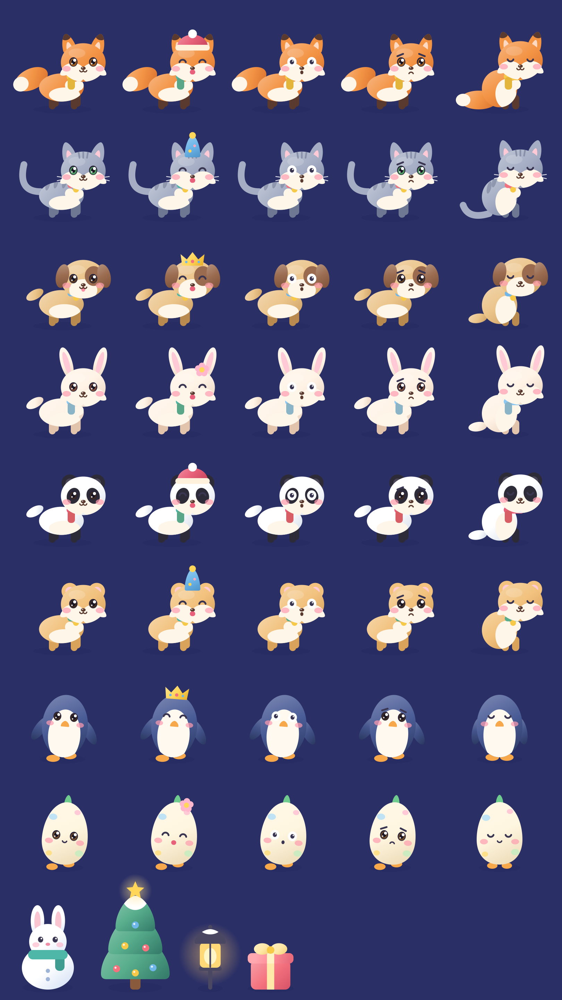

# Tuft

A small menu bar app for macOS that puts weather, scene wallpapers and a pet on your desktop.

Snow piles up on your windows and slides off when you drag them. A fox, cat, bunny, panda or one of four other pets lives beside the Dock, reacts to what you do, and stays out of the way while you work. You can pick it up and throw it, and it climbs onto your windows, plays with the icons in your menu bar and dances when music is on.


*Recorded from the app. The window and Dock here are a mock desktop; on your Mac it is your real windows and Dock.*

## See it

| Autumn leaves, golden hour | Spring petals, morning |
|---|---|
|  |  |

**The eight pets**, each shown normal, happy (with a hat), laughing, in love, surprised, sad, crying, dizzy and asleep, plus the decorations:



**The built-in wallpapers**, eight scenes with a picture for every time of day:


## Install

Tuft is not signed with an Apple developer certificate, so macOS blocks it the first time. This is expected.

1. Download `Tuft.zip` from the [latest release](../../releases/latest) and unzip it.
2. Drag `Tuft.app` into your **Applications** folder.
3. Double-click it. macOS says it cannot be opened. Click **Done**.
4. Open **System Settings ▸ Privacy & Security**, scroll down to the message about Tuft, and click **Open Anyway**. Confirm with your password or Touch ID.
5. Tuft starts. Look for the weather icon in the menu bar; there is no Dock icon and no window.

If step 4 shows nothing, run this in Terminal and open the app again:

```bash
xattr -dr com.apple.quarantine /Applications/Tuft.app
```

**Requirements:** macOS 14 or later, Apple silicon (M1 or newer).

### Updating

Choose **Check for updates…** in Tuft's menu to see whether there is a newer version. To update:

1. Download the new `Tuft.zip` from the [latest release](../../releases/latest) and unzip it.
2. Quit Tuft from its menu bar icon.
3. Drag the new `Tuft.app` into **Applications** and choose **Replace**.
4. Open it. macOS may block it again; repeat step 4 above. If you use **Open at login**, turn it on again.

Your pets, settings and your own pictures are kept.

Tuft needs no permissions. It never records your screen and never reads what you type.

## What it does

Everything is in the menu bar icon, grouped under **Weather**, **Wallpaper**, **Pets**, **Decorate**, **While I work** and **Settings**.

### Weather
- **Six kinds:** snow, leaves, starfall, rain, sakura, fireflies. Snow falls as small crystals, rain leaves ripples where it lands, and starfall streaks like meteors.
- **Snow piles** on window tops and the Dock, in uneven drifts, and falls off when a window moves. Set how deep under **Weather ▸ Snow depth**.
- **It settles on the ground too:** along the bottom of the screen snow builds a thin drift with a few mounds, rain leaves puddles here and there, autumn leaves and sakura petals gather in heaps, starfall leaves fallen stars and firefly nights grow glowing mushrooms. They come slowly and go when the weather changes. Pets and babies play in them: stomping in puddles, diving into heaps, flopping in the snow, wishing on a star. Turn this off with **Weather ▸ Settles on the ground**.
- **The pointer pushes things around:** it parts falling snow, sweeps settled snow into the air, scatters resting leaves, and fireflies gather when it rests.
- **Match real weather:** type your city once and Tuft follows the actual conditions.

### Wallpapers
- Eight scenes (snow, autumn, sky, village, rain, stars, fireflies, santa), each with its own picture for dawn, sunrise, morning, midday, golden hour, sunset, dusk and night.
- **Follow time of day** changes the picture as the day goes on. Choosing a weather by hand never changes the picture; **Wallpaper ▸ Scene ▸ Change with real weather** lets the scene follow **Match real weather**.
- **Any weather on any picture:** pick a scene under **Wallpaper ▸ Scene**, then choose what falls under **Weather**, for example sakura petals over the rain scene.
- Small pictures are enlarged with a sharpening filter so they stay crisp on a big screen. Nothing is redrawn or generated.
- **Restore my wallpaper** puts your own picture back.
- **Use my own pictures:** opens a folder for your own images. Name them by season (`winter-night.jpg`) or as a full scene with one picture per time of day (`snow-dawn.jpg` … `snow-night.jpg`); full scenes show up under **Wallpaper ▸ Scene**.

### Pets
- **Fox, cat, dog, bunny, panda, hamster, penguin or egg**, plus an optional second pet. Each can have a hat, a scarf or collar colour, and a name.
- **Where they live:** both sides of the Dock, a bottom corner, on the Dock, or on the menu bar. With two pets, they spend about half the time together and half on opposite sides.
- **Menu bar trips:** now and then a pet heads up to the menu bar and back by magic, balloon, umbrella, rocket, a big leap, a little cloud or a bubble. Turn this off with **Pets ▸ Visit the menu bar**.
- **Menu bar play:** up there they stroll, sprint, play with the icons on the right side of the bar (bounce on one, leapfrog over it, hide behind it, hang under it, polish it), and ride tiny cars, wagons, skateboards and sleds while the other one runs after them.
- **Window perching:** they climb onto the top edge of a window and sit there for a while. Turn this off with **Pets ▸ Climb onto windows**.
- **Pick them up:** click a pet over bare desktop, or Option-click one anywhere, to lift it by the scruff. It swings as you move, and lands on a window, the Dock or the ground when you let go. Let go while moving to throw it; drop it on the menu bar to leave it there.
- **Music:** when something is playing sound, they put on headphones and dance. Turn this off with **Pets ▸ Dance when music plays**.
- **Typing along:** while you type, one opens a little laptop or a book beside you.
- **Butterflies:** now and then one flutters by and they chase it.
- **They react to you:** they laugh, cry, fall in love and get dizzy. They check in with a little speech bubble when you have worked a long stretch, startle at nearby clicks, watch the pointer, nap when you're away and greet you when you come back. Rest the pointer on one to pet it.
- **Toys:** a ball, yarn, a leaf pile and a burrow on one side of the Dock; a little house, a food bowl and a bone on the other. The burrow and the house are a shortcut between the two sides. They all move along when the Dock gets wider or narrower.
- **Play with them:** pick up the ball, yarn or bone and drag it around and the pets run after it and jump for it. Let go while moving to throw it. On their own they bat the ball and yarn about and carry the bone off for a chew.
- **Games for two:** with two pets, they play catch, fly paper planes, blow and pop bubbles, high five, and build something together: a snowman in snow, a leaf heap in autumn, a sandcastle otherwise. In rain they share an umbrella.
- **Babies:** pick one pet up and set it down beside the other and they cuddle; a baby arrives (sometimes twins or triplets), up to five in all and no more often than every 45 seconds. A baby is a small copy of one parent, or a mix of the two (fox, cat, dog, bunny and hamster can mix). Babies follow their parents, nap when they do, nudge the ball, jump for a toy you hold, like being petted, and can be picked up and dropped like their parents. Turn this off, or send the babies off, under **Pets ▸ Babies**.
- **Mood:** petting and play make them happier. Ignored for a long time, they mope.

### Decorations
- Place a snow bun, a little tree, a lantern or a gift anywhere. Drag to move, right-click to remove.
- **Roll a snowball:** push it with the pointer. It grows as it rolls and becomes a snowman.

### Staying out of your way
- **Calm while I work:** weather is drawn faintly over the window you're using, and thins out while you type.
- **Weather stays behind the active window:** nothing falls in front of the window you're using at all.
- **Focus timer:** 25 minutes with the pets asleep and a small celebration at the end.
- **Hide during calls:** everything disappears while an app is using your microphone or camera.
- **Ambient sound** (off by default): soft rain, wind or night crickets.
- **Open at login.**

It draws on the graphics chip at 30 frames a second and stops under full-screen apps. On battery it drops to 20 frames a second, halves the weather, checks window positions less often, and goes to sleep after you have been away for three minutes.

## Privacy

- Tuft works offline unless you turn on **Match real weather** or choose **Check for updates…**. Real weather sends the city name you typed, and that city's coordinates, to [Open-Meteo](https://open-meteo.com). Checking for updates asks GitHub for the newest version number, only when you click it. Nothing else leaves your Mac.
- Typing and click reactions use only the time since the last key press or click. Tuft cannot see which keys you press.
- Call detection asks macOS whether the microphone or a camera is in use. Tuft never opens either.
- Music detection asks macOS whether any app is sending sound to the speakers. Tuft never listens to the sound and does not know what is playing.
- Menu bar play uses only the position and size of the icons in the menu bar. Tuft does not read their names or what they show.

## Known limits

- The Dock's width is worked out from the icons in it, so snow and pets can sit a few points off its real edges, and a magnified Dock is not followed.
- If you keep the menu bar always hidden, a window that fills the whole screen is treated as full screen and Tuft hides.
- Snow does not pile on maximised windows, because their top edge is under the menu bar.
- Sharing your screen with the microphone and camera both off is not detected.
- On the menu bar, pets may overlap menu titles or status icons.
- **Open at login** may be refused for an unsigned app. If so, add Tuft under **System Settings ▸ General ▸ Login Items**.

## Build from source

You need the Xcode Command Line Tools (`xcode-select --install`). Full Xcode is not required.

```bash
./build.sh
```

```bash
open build/Tuft.app
```

The source is a Swift package using AppKit and SpriteKit:

| File | What it holds |
|---|---|
| `Sources/Tuft/App.swift` | Menu, overlay windows, timers, weather sync, call detection |
| `Sources/Tuft/Scene.swift` | Weather particles, snow piles, pets, toys, decorations |
| `Sources/Tuft/Play.swift` | Feelings, music, picking pets up, menu bar play |
| `Sources/Tuft/Family.swift` | Games for two pets, and babies |
| `Sources/Tuft/Ground.swift` | What the weather leaves on the ground |
| `Sources/Tuft/Art.swift` | Pets, hats, toys and decorations, drawn in code |
| `Sources/Tuft/Painter.swift` | Wallpaper tinting and a code-drawn fallback scene |
| `Sources/Tuft/Sound.swift` | Synthesized ambient sound |
| `Wallpapers/` | The eight painted scenes |

## Credits

The pets, toys and decorations are drawn in code. The wallpaper art is from [koiart.app](https://koiart.app/), used with the artist's permission.
